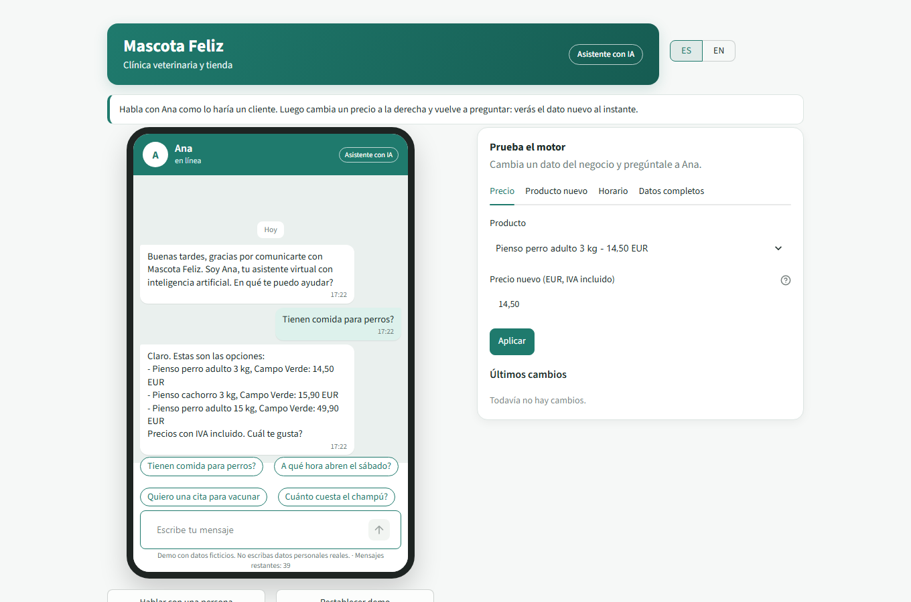
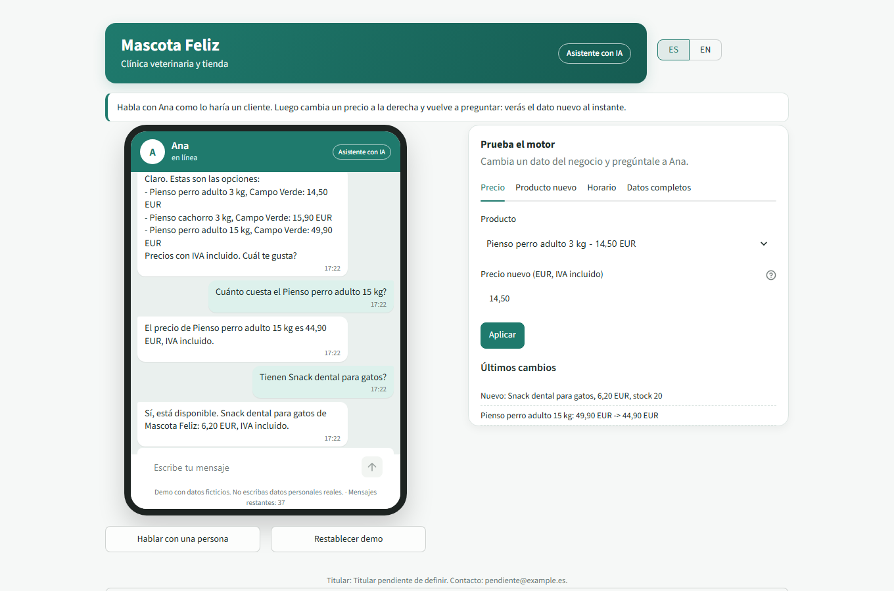
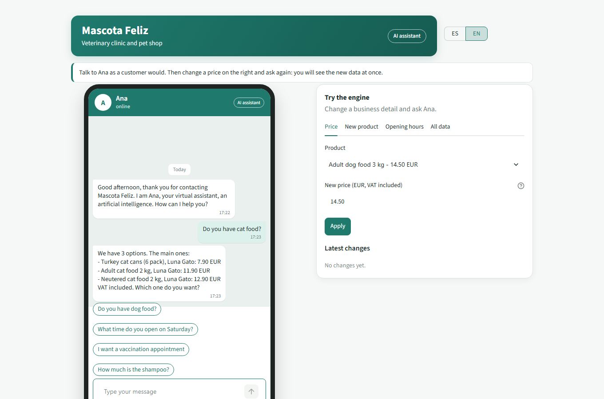

# Mascota Feliz: motor conversacional para negocios veterinarios

[Español](#español) | [English](#english)



---

## Español

Demo de un asistente con IA para una clínica veterinaria con tienda. Responde
precios, productos, horarios y citas, en español y en inglés.

Lo importante: **el bot nunca inventa datos.** Cada precio, horario y stock sale
de la base de datos. Si cambias un precio en el panel, el bot responde con el
precio nuevo en el mensaje siguiente.

**[Probar la demo](ENLACE_DE_LA_DEMO)**

### Qué puedes probar

| Prueba | Qué pasa |
|---|---|
| "Tienen comida para perros?" | Lista corta con marca y precio |
| Cambiar un precio en el panel | El bot da el precio nuevo al instante |
| Añadir un producto | El bot lo encuentra en el mensaje siguiente |
| Cambiar a EN | Interfaz y respuestas en inglés |
| "Eres una persona?" | Dice la verdad: es una IA |
| "Quiero hablar con una persona" | Da el contacto del equipo |

| Cambio de precio en caliente | Producto nuevo |
|---|---|
|  |  |



### Cómo funciona

```
Mensaje -> Entender (IA, solo JSON) -> Reglas (base de datos) -> Redactar (IA) -> Validador -> Respuesta
```

| Parte | Qué hace |
|---|---|
| `core/entender.py` | La IA saca la intención y los datos del mensaje. No escribe al cliente. |
| `core/reglas.py` | Busca en la base de datos: precio, stock, horarios, huecos de cita. |
| `core/redactar.py` | La IA escribe la respuesta usando solo esos datos. |
| `core/validador.py` | Rechaza la respuesta si trae un número o nombre que no está en los datos. |
| `core/plantillas.py` | Respuestas seguras sin IA si algo falla. |
| `core/privacidad.py` | Quita teléfonos, correos y DNI antes de enviar nada a la IA. |

### Pensado para la ley europea

- Aviso de IA en el primer mensaje y etiqueta fija (Ley de IA de la UE, art. 50).
- Siempre se puede pedir hablar con una persona.
- No guarda datos personales. Cada visita tiene su propia base en memoria.
- Precios con IVA incluido.

Detalle en `docs/01_LEGAL_UE_ESPANA.md`. No es asesoría jurídica.

### Ejecutar en tu equipo

```
pip install -r requirements.txt
streamlit run app.py
```

Para usar IA, crea `.streamlit/secrets.toml` a partir de `.streamlit/secrets.toml.example`.
Sirve cualquier proveedor con API compatible con OpenAI (OpenRouter, Mistral, DeepSeek...).
Sin clave, la app arranca en modo básico.

Pruebas:

```
pip install -r requirements-dev.txt
pytest
```

### Tecnología

Python, Streamlit, SQLite en memoria, rapidfuzz. Sin Docker.

### Licencia

Código abierto bajo [GNU AGPL-3.0](LICENSE). Si usas este código en un servicio
en línea, debes publicar tus cambios con la misma licencia.

¿Quieres una versión privada para tu negocio, con WhatsApp y tus datos? Escríbeme.

---

## English

AI assistant demo for a veterinary clinic with a pet shop. It answers prices,
products, opening hours and appointments, in Spanish and English.

The key point: **the bot never makes up data.** Every price, opening hour and
stock level comes from the database. Change a price in the panel and the bot
uses the new price in its very next reply.

**[Try the demo](ENLACE_DE_LA_DEMO)**

### What to try

| Try | What happens |
|---|---|
| "Do you have cat food?" | Short list with brand and price |
| Change a price in the panel | The bot gives the new price at once |
| Add a product | The bot finds it in the next message |
| Switch to ES | Interface and replies in Spanish |
| "Are you a person?" | It tells the truth: it is an AI |
| "I want to talk to a human" | It gives the team contact |

### How it works

```
Message -> Understand (AI, JSON only) -> Rules (database) -> Write (AI) -> Validator -> Reply
```

The AI understands and writes. The rules and the database decide the facts.
A validator rejects any reply with a number or name that is not in the data.
If the AI fails, safe templates answer instead.

### Built for EU rules

- AI notice in the first message and a fixed label (EU AI Act, art. 50).
- Users can always ask for a human.
- No personal data is stored. Each visit has its own in-memory database.

Not legal advice.

### Run locally

```
pip install -r requirements.txt
streamlit run app.py
```

Add an OpenAI-compatible API key in `.streamlit/secrets.toml`
(see `.streamlit/secrets.toml.example`). Without a key, the app runs in basic mode.

### License

Open source under [GNU AGPL-3.0](LICENSE). Want a private version for your
business, with WhatsApp and your own data? Get in touch.

---

## Para desarrolladores

Especificación completa en `docs/`. Orden de lectura:

1. `AGENTS.md` (reglas de código)
2. `docs/01_LEGAL_UE_ESPANA.md`
3. `docs/02_CONVERSACION.md`
4. `docs/03_ARQUITECTURA_Y_PLAN.md`
5. `docs/04_DATOS_FICTICIOS.md`
6. `docs/05_CONTRATOS_Y_PROMPTS.md`
7. `docs/06_DESPLIEGUE_STREAMLIT.md`
8. `docs/07_TEXTOS_I18N.md`
9. `docs/08_MEJORAS_V2.md`
10. `docs/DECISIONES.md` y `docs/ESTADO.md`

Copyright (C) 2026 jorgesislema
